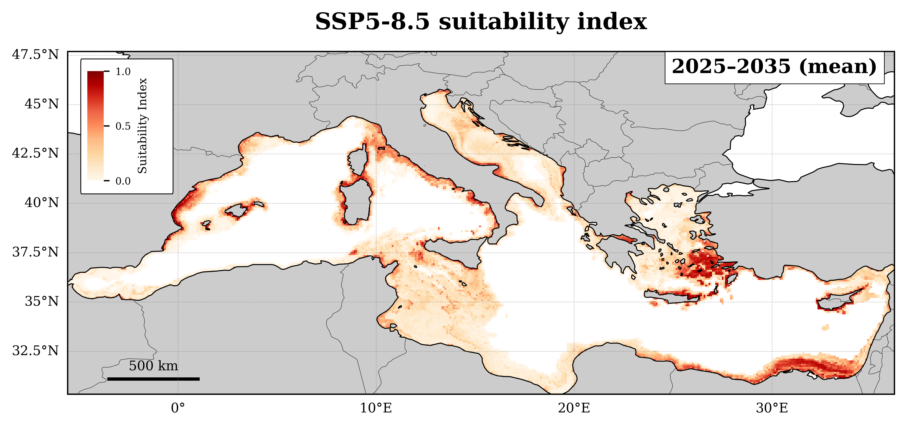

# Environmental_Suitability_Alien_Species

## Overview

This repository contains the Python code used to generate the figures presented in the scientific paper:

**Machine Learning Projections of Future Environmental Suitability to Marine Alien Species in the Mediterranean Sea.**

The study applies an XGBoost machine learning approach to evaluate present and future environmental suitability for marine alien species across the Mediterranean Sea under different climate change scenarios.

## Repository contents

- `Scripts/`: Python scripts used to reproduce the figures presented in the manuscript.
- `Data/`: Example input data, where applicable.
- `Results/`: Final figures produced, examples.

## Requirements

Main dependencies include:

- NumPy
- Pandas
- Xarray
- Scikit-learn
- XGBoost
- Matplotlib
- Cartopy
- GeoPandas

## Data availability

The environmental datasets and species occurrence records used in this study were obtained from external sources.

Please refer to the manuscript for the complete description of the datasets and their original sources.

Large input datasets are not included in this repository. Users should obtain them directly from the respective data providers, subject to their terms of use.

## Reproducing the figures

Each figure can be generated using the corresponding Python script in the `figures/` directory.

Before running the scripts:
1. Download and prepare the required input datasets.
2. Update the paths in the configuration file.
3. Install the required Python dependencies.
4. Run the corresponding figure script.

## Licence

This project is licensed under the MIT License. See the `LICENSE` file for details.
