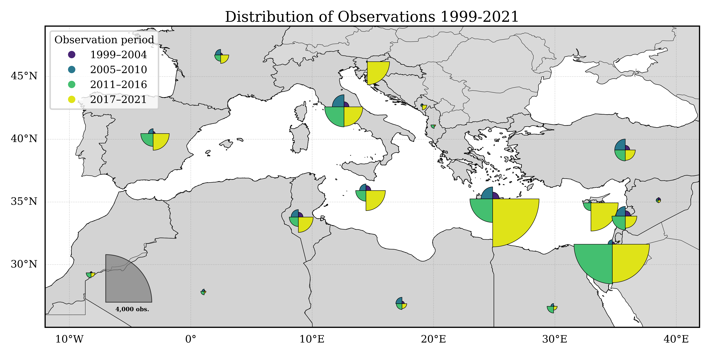
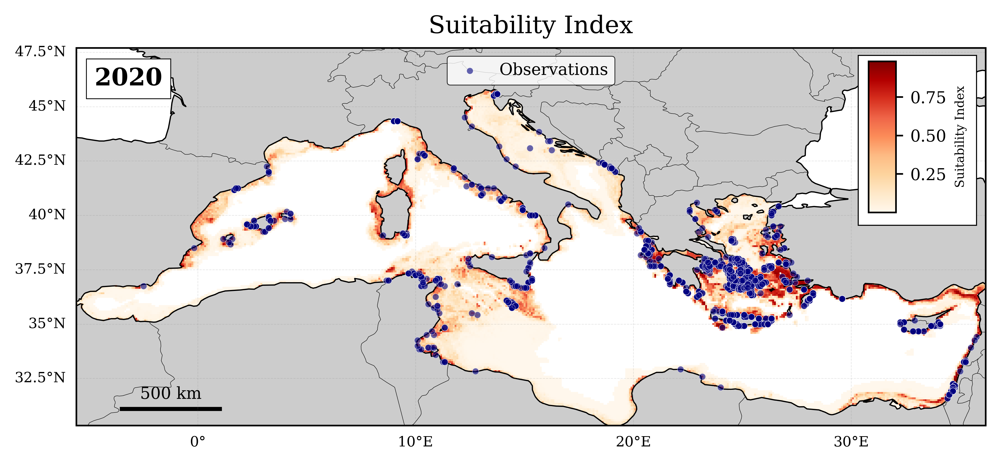
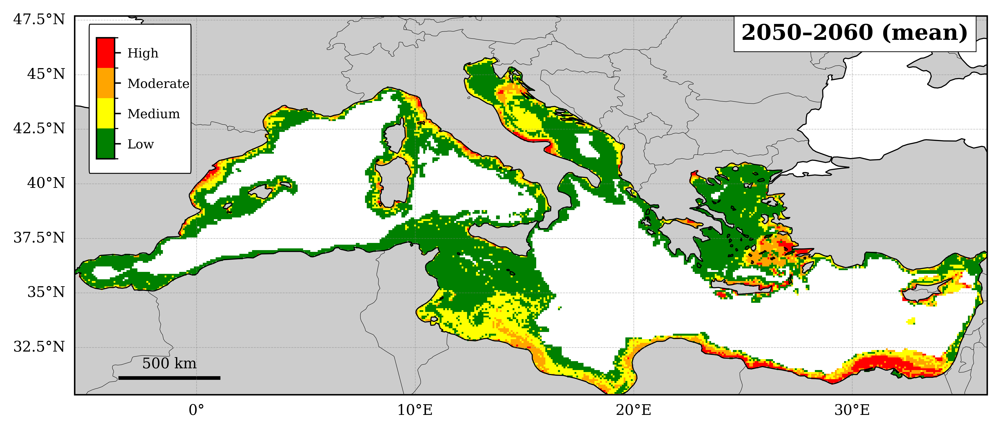
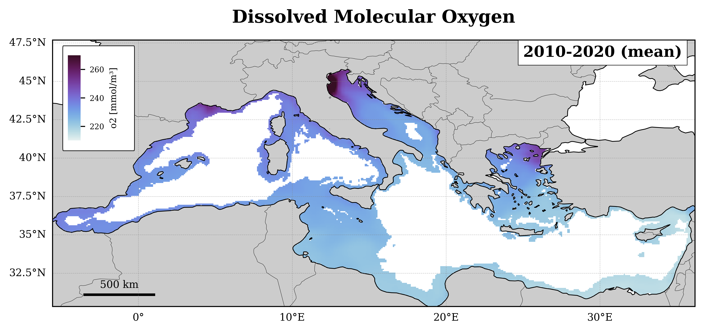
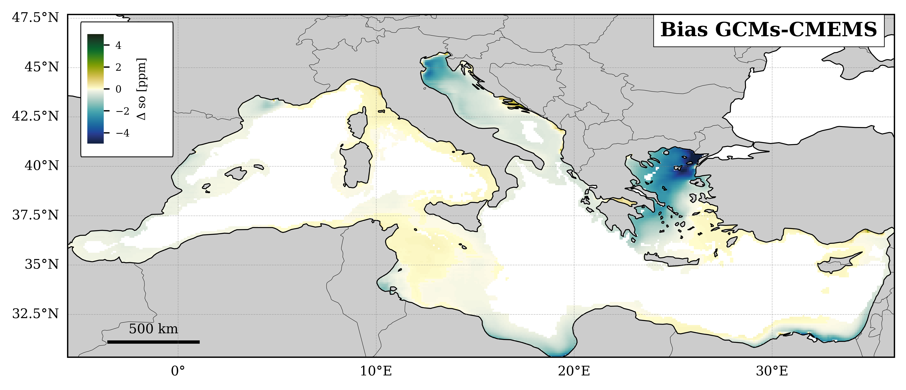

## Results and Figures

The Python script provides a set of plotting routines to reproduce the main and supplementary figures presented in the manuscript. The functions generate spatial maps of marine alien species observations, environmental suitability, suitability categories, and baseline and projected environmental conditions across the Mediterranean Sea.

Example outputs are shown below. The figures can be reproduced by running the corresponding plotting routines with the datasets described in the [Data](#data) section.

### Figure 1 – Distribution of marine alien species observations

Map showing the distribution of marine alien species observation records across Mediterranean countries, grouped into four periods: 1999–2004, 2005–2010, 2011–2016, and 2017–2021.

The quarter-circle symbols represent the number of observations recorded in each period.

### Figure 2 – Past environmental suitability

Spatial distribution of the environmental suitability index for a selected year from the historical dataset. The map can optionally include the corresponding marine alien species observation records for that year.

The function `Past_Med_Suitability_Observations()` allows the user to select the year and choose whether to display the observation points.

### Figure 3 – Future environmental suitability projections

Spatial distribution of the projected environmental suitability index under future climate scenarios. The function `plot_Med_Suitability()` can display either a single year or the mean suitability over a selected period.

The same function can be used with different datasets to compare SSP2-4.5 and SSP5-8.5 projections, including the near-future (2025–2035), mid-century (2050–2060), and end-of-century (2085–2095) periods.

### Figure 4 – Suitability categories

Spatial distribution of environmental suitability classified into four categories:

- Low: 0–0.25
- Medium: 0.25–0.50
- Moderate: 0.50–0.75
- High: 0.75–1.00

The function `plot_Med_Suitability_Area_Cat()` also calculates the percentage of the valid study area occupied by each category, using cosine-of-latitude weights to approximate grid-cell area.

### Figure 5 – Baseline environmental conditions

Maps showing the spatial distribution of baseline environmental conditions, calculated as the mean over the 2010–2020 period.

The function `plot_Baseline_Climate()` can be used to plot the different environmental variables individually, including potential temperature (`thetao`), salinity (`so`), and dissolved molecular oxygen (`o2`).

### Figure 6 – Projected changes in environmental conditions

Maps showing projected changes in environmental variables relative to the 2010–2020 baseline period.

The function `plot_Difference_Baseline_Climate()` calculates the difference between future projections and baseline conditions. It can be used to visualize changes for the near-future (2025–2035), mid-century (2050–2060), and end-of-century (2085–2095) periods.

The function also supports plotting the difference between GCM and CMEMS baseline conditions by setting `scenario=False`.

